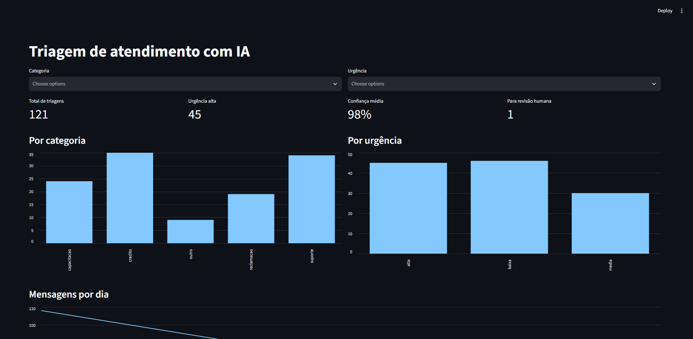
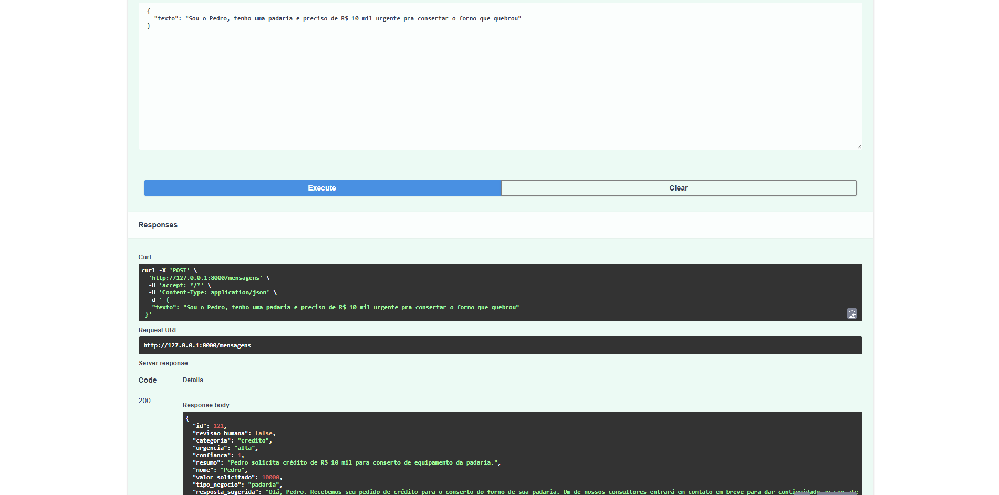
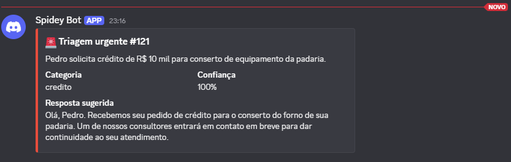

<h1 align="center">
  Triagem de atendimento com IA
</h1>

Uma API que lê mensagens de pequenos empreendedores (pedido de crédito, dúvida sobre curso, problema no app, reclamação) e usa um LLM para decidir de que se trata, o quão urgente é e quais dados a pessoa já deu. O resultado vai para um banco, uma planilha do Google, um dashboard e, quando é urgente, para um canal do Discord.

Fiz para praticar integração de IA com ferramentas do dia a dia, usando um cenário de atendimento a pequenos negócios. Todas as mensagens são fictícias para o projeto.



## O que ela faz

Chega uma mensagem como esta:

> Sou o Pedro, tenho uma padaria e preciso de R$ 10 mil urgente pra consertar o forno que quebrou

E a API devolve:

```json
{
  "categoria": "credito",
  "urgencia": "alta",
  "confianca": 1,
  "resumo": "Pedro solicita R$ 10 mil para conserto de equipamento da padaria.",
  "nome": "Pedro",
  "valor_solicitado": 10000,
  "tipo_negocio": "padaria",
  "resposta_sugerida": "Olá, Pedro. Recebemos seu pedido de crédito para sua padaria. [...]",
  "revisao_humana": false
}
```

Em seguida salva no SQLite, adiciona uma linha na planilha e, como a urgência é alta, manda um alerta no Discord. Se a confiança do modelo fica abaixo de 0,7, a mensagem é marcada para uma pessoa revisar.




## Quanto ela acerta
 
Em 30 mensagens fictícias (geradas com ajuda de IA, com a categoria esperada definida antes), a classificação acertou 29 (97%) depois de um ajuste no prompt. O único erro é ambíguo: "não consigo acessar as aulas da plataforma de cursos" pode ser suporte ou capacitação.
 
Como o ajuste foi feito olhando esses erros, o número é otimista. Em outras 10 mensagens, rodadas sem mexer no prompt, acertou as 10. São amostras pequenas e de estilo parecido, então não garantem o mesmo resultado com mensagens reais.
 
## O que deu errado no caminho
 
- A IA inventou um link ("acesse nosso portal pelo link [link]") numa resposta sugerida. Corrigi com uma regra no prompt: não inventar links, prazos ou procedimentos.
- Uma rodada de testes mostrou 100% porque só contava as mensagens que não tinham falhado por limite de cota. O script agora reporta as falhas separadamente.
- Repetir na hora depois de um erro 429 só piorava. O retry agora espera mais a cada tentativa e só repete em erros temporários.

## Como rodar

Precisa de Python 3.11+ e uma chave da API do Gemini (Google AI Studio).

```bash
git clone https://github.com/naju-dias/triagem-ia.git
cd triagem-ia
python -m venv .venv
source .venv/bin/activate        # no Windows: .venv\Scripts\Activate.ps1
pip install -r requirements.txt
cp .env.example .env             # e preencha
```

No `.env`:

```
GEMINI_API_KEY=
GEMINI_MODEL=
DISCORD_WEBHOOK_URL=
GOOGLE_SHEET_ID=
GOOGLE_CREDENTIALS=credentials.json
```

O Discord e a planilha são opcionais: se as variáveis estiverem vazias, ele pula essas etapas.

```bash
uvicorn app.main:app --reload     # API em http://127.0.0.1:8000/docs
streamlit run dashboard/app.py    # dashboard em http://localhost:8501
```

Para rodar a avaliação com a API no ar:

```bash
python scripts/rodar_exemplos.py v2
python scripts/rodar_exemplos.py validacao data/mensagens_validacao.json
```

## O que falta

- Testes automatizados para o classificador
- Uma tela para a pessoa revisar os casos de baixa confiança
- Trocar o SQLite por Postgres e colocar as chamadas ao LLM numa fila

##
<div align="center">

Desenvolvido por **Ana Julia Dias**
[GitHub](https://github.com/naju-dias) | [LinkedIn](https://www.linkedin.com)

</div>
